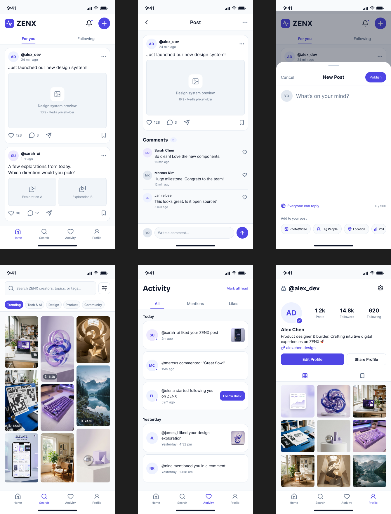

# ZENX — Mobile Interactive Prototype & Usability Testing

ZENX started out as a rough set of mobile wireframes and evolved into a functional 6-screen clickable prototype built in Figma[cite: 1, 2]. The goal was to build a clean, social space centered around creators, then test the actual navigation and interactions to see where users felt friction and fix it before writing any code[cite: 1, 2].

---

## 🔗 Project Links

- **Figma Design & Prototype File:** [Open ZENX in Figma](https://www.figma.com/design/BdOvwOgTdRJxrg66TgNltA/Untitled?node-id=0-1&t=z3huOGdF7KlmcvAf-1)
- **Interactive Prototype Play Mode:** [Test the Live Prototype Flow](https://www.figma.com/proto/BdOvwOgTdRJxrg66TgNltA/Untitled?node-id=0-1&t=z3huOGdF7KlmcvAf-1&scaling=scale-down&starting-point-node-id=0%3A1)

---

## 📱 What Was Built

The prototype focuses on a core 6-screen loop built on an iPhone 16 layout using auto layout and standard mobile design patterns:

- **Home Feed (`Feed`):** The primary hub featuring post cards, author details, media previews, engagement stats (likes, comments), and persistent bottom navigation[cite: 2].
- **Discussion Thread (`Post_Detail`):** An expanded view of a post where users can read through community comments and type a reply[cite: 2].
- **Composer Sheet (`Create_Post`):** A slide-up bottom modal designed for quick posting, complete with media tags and explicit exit options[cite: 2].
- **Search & Discovery (`Search`):** A focused explore view featuring a search bar, category chips (Tech, UI/UX, Design), and a photo/video grid[cite: 2].
- **Activity Hub (`Activity`):** An aggregated feed tracking new likes, comments, and followers with an inline "Follow Back" action[cite: 2].
- **User Profile (`Profile`):** The personal space displaying post count, follower metrics, bio links, and a 3-column media grid[cite: 2].

*(All raw design screen exports and asset packages are archived inside `screens.zip` in this repository).*

---

## ⚡ Interactions & Motion

- **App-Wide Navigation:** Tapping across the bottom bar switches screens instantly without lag, matching how native iOS tabs behave[cite: 2].
- **Screen Transitions:** Clicking into comments uses a directional slide transition to give a clear sense of depth and hierarchy[cite: 1, 2].
- **Overlay Behavior:** The "New Post" screen slides up over a dimmed background so the user never loses context of where they were in the feed[cite: 2].

---

## 🧪 Real User Testing

I sat down with a couple of peers and asked them to complete three basic everyday tasks without giving them any prior guidance:

1. *Explore the app:* Jump across each tab in the navigation bar to see what's there[cite: 2].
2. *Join the conversation:* Open the comments on the first post in the feed and find their way back home[cite: 2].
3. *Create content:* Open the post creator, look around the options, and exit without publishing[cite: 2].

### What People Actually Said & Noticed
- **The Good:** Everyone immediately understood the bottom navigation bar and liked that they could jump straight to Search or Profile from anywhere[cite: 2].
- **The Catch:** 
  - When opening the Post Detail screen, one user reflexively looked for an obvious back arrow at the top-left to return to the feed. My initial connection was tied to the post card area rather than the back chevron, which caused brief confusion[cite: 2].
  - On the "New Post" modal, another tester tried tapping the dimmed background to close it, but when that felt ambiguous, they hesitated looking for a text button[cite: 2].

---

## 🛠 What Changed After Feedback

Based on how users actually moved through the screens, I made a few direct adjustments:

- **Clear Exit Paths:** Added a distinct "Cancel" text trigger on the top-left of the New Post sheet alongside the backdrop tap-to-dismiss behavior[cite: 2].
- **Fixed Back Navigation:** Cleaned up the Post Detail top bar so the back chevron explicitly links straight back to the Home Feed[cite: 2].
- **Active State Highlights:** Made active tab states much clearer in indigo (`#4F46E5`) so testers always knew which screen was active at a glance[cite: 2].

---

## 📄 Submission Details
- **Assignment:** Interactive Prototype Creation[cite: 1]
- **Submission Date:** 13 Oct 2026[cite: 1]
